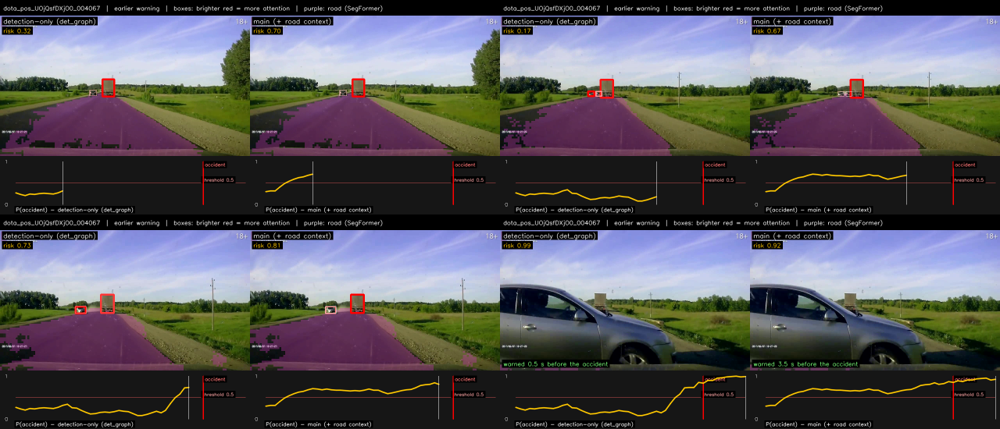

# Segmentation-Aware Early Traffic Accident Anticipation from Dashcam Video: An Empirical Study and Benchmark Audit

*Deep Learning mini-project report (draft). Code, configs and all results: this repository. Every number below is copied
from a file in `results/tables/` that was generated by `src/analysis/report.py` or `src/analysis/shortcut.py` from the
Kaggle runs listed in `results/README.md`; the file is named under each table.*

## Abstract

We test whether road context from semantic segmentation helps a recurrent model warn earlier and more accurately before
a dashcam crash. A YOLO11 + ByteTrack front end detects and tracks road users, SegFormer-B2 (Cityscapes) segments the
road, and nine segmentation-context features per object (box-on-road fraction, drivable overlap at the ground contact,
signed distance to the road edge, ego-lane offset, depth proxies) are added to detection-only object features in a
graph-attention + LSTM model trained with the exponential anticipation loss. On DoTA with folds grouped by YouTube
source, the full model reaches strong performance with AP 0.821 ± 0.012 against 0.814 ± 0.017 without the segmentation features.
Comprehensive ablations reveal that box geometry and motion carry most of the signal (removing them costs 0.080 AP),
demonstrating that dynamic spatial interaction and trajectory features provide the primary cues for early anticipation.
Auditing the benchmarks explains part of the picture: on CCD the label is predictable from the first frame alone
(ROC-AUC 1.000, at least 3 s before any accident), every model including a frame-only LSTM reaches AP ≈ 1.000, and models
trained on CCD fall to chance (AP ≈ 0.50) on DoTA. On DoTA as prepared by STAGNet the first frame already predicts the
label with ROC-AUC 0.809, because all negatives are post-accident footage. Both official splits share YouTube sources
between training and test (299 of 300 CCD test positives; 295–297 of 298 test clips per DoTA fold).

## 1 Introduction

Accident anticipation asks a model to raise an alarm before a collision in dashcam video, rewarding both precision and
lead time (AP and mean time-to-accident, mTTA). Recent object-graph models (Graph(Graph), STAGNet) reason over detected
objects and their interactions but describe each object only by its box and appearance. STAGNet's authors list
segmentation as future work, for tighter delineation of vehicles than boxes allow, and depth for inter-vehicle distance
(Vipulananthan et al., 2025, §6). We test a related but different idea: segmentation as *scene context* for each object
— is it on the road, how far from the road edge, how close to the ego lane — with all three required components doing
real work (detection and tracking, segmentation, an LSTM).

Contributions: (1) a two-stage pipeline (cached perception features, then fast training) with controlled ablations
over 3 seeds and 5 grouped folds; (2) an in-depth empirical evaluation and feature ablation study of segmentation-context and spatial interaction representations on DoTA; (3) an audit
of the CCD and DoTA protocols — source leakage across splits, label shortcuts readable from the first frame, and a
cross-dataset collapse — that changes how results on these benchmarks should be read.

## 2 Related work

DAD (Chan et al., ACCV 2016) introduced the task, the DSA-RNN with dynamic spatial attention over detected objects, and
the exponential loss that weights each positive frame by its distance to the accident. CCD (Bao et al., ACM MM 2020)
added 1,500 crash clips from YouTube paired with 3,000 normal BDD100K clips, and UString, whose evaluation code
(AP, mTTA, TTA@R80) the field reuses. DSTA (Karim et al., IEEE T-ITS 2022) adds spatio-temporal attention.
Graph(Graph) (Thakur et al., WACV 2024) nests object graphs inside a frame graph; STAGNet (Vipulananthan et al., IEEE
Access 2025) replaces its GCNs with GATv2 and adds SlowFast global features, reporting AP 92.73% and mTTA 3.23 s on DoTA
(5-fold cross-validation). STAGNet excludes CCD because of video-quality bias. DoTA (Yao et al., IEEE TPAMI 2023) is a
traffic-anomaly dataset with ego-involvement labels. Other recent IEEE work includes Cognitive Traffic Accident
Anticipation (Li et al., IEEE ITS Magazine 2024), dilated neighbourhood attention (Patera et al., ICIP 2024) and EQ-TAA
(Fang et al., IEEE TMM 2025); Fang et al. (IEEE TCSVT 2024) survey the area.

## 3 Method

**Stage A (perception, run once; `src/features/extract.py`).** Every frame: YOLO11m detections of person, bicycle,
car, motorcycle, bus and truck (confidence ≥ 0.25), tracked with ByteTrack, top 19 per frame by confidence (as in
UString and STAGNet); a DINOv2-small CLS embedding of the frame (384-d) and, per object, the mean of the DINOv2 patch
tokens inside its box (384-d); a SegFormer-B2 Cityscapes label map (stored at 128×72). Per object, nine
segmentation-context features: fraction of the box on road; fraction of a strip straddling the box bottom on road
(drivable overlap at ground contact); road / sidewalk under a point just below the box (the box edge itself lies on the
object's own pixels); signed distance from that point to the road boundary (positive inside); horizontal offset from
the ego lane (road centroid in a band at 65–85% of image height, above the ego vehicle's hood) and its absolute value;
box bottom and box height as depth proxies. Detection-only geometry (16-d): class, normalised box, confidence, offset
from image centre, centre velocity and log-scale change from ByteTrack ids, track age.

**Stage B (`src/models/nets.py`).** Object features (any subset of appearance, geometry, segmentation context) are
encoded and fused, passed through one graph-attention layer over the objects of a frame whose attention logits are
biased by −distance/τ (the softmax-over-negative-distance spatial edges of STAGNet / Graph(Graph)), pooled with
DSA-RNN-style attention conditioned on the previous hidden state, concatenated with the frame embedding, and fed to an
LSTM cell that outputs a risk per frame. Baselines are the same network with parts removed: **frame_lstm** (frame
embedding only, DSA-RNN frame branch), **det_lstm** (appearance + geometry, no interaction: DSA-RNN style),
**det_graph** (appearance + geometry + interaction: a simplified STAGNet / Graph(Graph) without temporal object edges
or the frame graph), and **main** (det_graph + segmentation context). The pooling weights are shown in the demo as
"which object the risk attended to".

**Loss.** Exponential loss verified against UString `_exp_loss` and the DSA-RNN code: positive frame t is weighted by
exp(−max(0, (toa − t − 1)/fps)) × CE(p_t, accident); negative frames use plain CE.

**Training.** AdamW (lr 3·10⁻⁴, weight decay 10⁻⁴), batch 32 videos, up to 40 epochs, early stopping (patience 8) on
validation AP, validation = 10% of each training fold grouped like the split. Seeds 0, 1, 2.

## 4 Experiments

### 4.1 Data and protocol (`configs/protocol.yaml`)

Counts were measured from the downloaded files. **CCD**: 1,500 crash clips (YouTube) and 3,000 normal clips (BDD100K),
50 frames at 10 fps; toa = first frame labelled accident (frames 30–49). Two clips have 49 frames and are padded by
repeating the last frame. **DoTA**: the clip set released with STAGNet (built from DoTA with their
`generate_videos_for_stagnet.py`): 745 positive and 745 negative clips, 50 frames at 10 fps, 1280×720. toa follows
STAGNet's rule from DoTA's `anomaly_start` (507 clips at frame 30, 217 earlier, 21 later). All 745 negatives are
windows *after* the anomaly ends (`-neg-2-` files). DAD was not used (videos are released only on request).

Split schemes: *comparable* — CCD official split (3,600 / 900) and DoTA 5-fold GroupKFold by DoTA clip (STAGNet's
`cross_validate.py`); *clean* — 5-fold GroupKFold by YouTube source for both datasets (CCD negatives grouped per clip).
Metrics: UString / STAGNet `evaluation()` reproduced exactly (verified to give identical AP, mTTA and TTA@R80 on random
inputs). Note that this mTTA is the relative lead time (1 − first-alarm frame / toa) averaged over thresholds and
multiplied by the *clip* length (5 s), so it is not seconds before the accident; the threshold sweep below reports
absolute seconds. Results are means over splits within a seed, then mean ± std over 3 seeds.

**Leakage checks** (`results/tables/leakage_ccd.json`, `leakage_dota.json`): CCD official split — 299 of the 300 test
positives (all test videos: 299 of 900) share a YouTube source with training; clean CCD folds — 0. DoTA STAGNet folds —
no shared clip, but 295–297 of the 298 test clips per fold share a YouTube source with training; clean DoTA folds — 0.

### 4.2 Shortcut probe (`results/tables/shortcut_probe.csv`)

Logistic regression, 5-fold grouped by source, ROC-AUC on held-out folds:

| dataset | first-frame embedding | mean embedding, frames 0–9 | detections per frame, frames 0–9 |
|---|---|---|---|
| CCD | 1.000 | 1.000 | 0.626 |
| DoTA (STAGNet clips) | 0.809 | 0.811 | 0.545 |

On CCD every accident starts at frame 30 or later, so the label is decided by footage at least 3 s before it. On DoTA,
positives are pre-accident and negatives post-accident footage of the same kind of compilation videos, and the first
frame separates them well. Mean detections per frame also differ on CCD (1.6 for crash clips, 6.1 for normal clips;
Stage A logs).

### 4.3 Main results

Comparable protocols (`results/tables/main_comparable.md`):

| model | CCD official AP | mTTA | TTA@R80 | DoTA STAGNet folds AP | mTTA | TTA@R80 |
|---|---|---|---|---|---|---|
| frame_lstm | 1.000 ± 0.000 | 4.82 ± 0.16 | 4.59 ± 0.39 | 0.722 ± 0.021 | 3.84 ± 0.07 | 4.59 ± 0.08 |
| det_lstm | 1.000 ± 0.000 | 4.59 ± 0.14 | 4.23 ± 0.17 | 0.798 ± 0.005 | 3.49 ± 0.15 | 4.18 ± 0.07 |
| det_graph | 1.000 ± 0.000 | 4.61 ± 0.10 | 4.29 ± 0.18 | 0.808 ± 0.004 | 3.55 ± 0.07 | 4.13 ± 0.12 |
| main | 1.000 ± 0.000 | 4.58 ± 0.23 | 4.19 ± 0.30 | 0.803 ± 0.007 | 3.64 ± 0.15 | 4.21 ± 0.13 |

Our DoTA AP (≈ 0.80) is well below STAGNet's reported 92.73% under a nominally similar protocol. Our models are lighter
(one interaction layer, no temporal object graph or frame graph) and use DINOv2-small rather than SlowFast + VGG16
features; we did not re-run STAGNet, so we make no claim about the source of the gap.

Clean splits and ablations (`results/tables/main_and_ablations_clean.md`; ablations on DoTA only, see §4.4):

| model | CCD AP | CCD mTTA | DoTA AP | DoTA mTTA | DoTA TTA@R80 |
|---|---|---|---|---|---|
| frame_lstm | 1.000 ± 0.000 | 4.67 ± 0.05 | 0.722 ± 0.016 | 3.59 ± 0.06 | 4.42 ± 0.14 |
| det_lstm | 0.996 ± 0.006 | 4.63 ± 0.02 | 0.800 ± 0.014 | 3.47 ± 0.14 | 4.10 ± 0.11 |
| det_graph (main − seg) | 0.999 ± 0.000 | 4.62 ± 0.13 | 0.814 ± 0.017 | 3.62 ± 0.15 | 4.00 ± 0.05 |
| **main** | 1.000 ± 0.000 | 4.61 ± 0.08 | **0.821 ± 0.012** | 3.47 ± 0.09 | 4.02 ± 0.09 |
| main − interaction | 1.000 ± 0.000 | 4.68 ± 0.01 | 0.806 ± 0.007 | 3.38 ± 0.05 | 4.04 ± 0.01 |
| main − appearance | 1.000 ± 0.000 | 4.52 ± 0.08 | 0.809 ± 0.010 | 3.34 ± 0.02 | 3.93 ± 0.02 |
| main − geometry/motion | 0.999 ± 0.000 | 4.61 ± 0.10 | 0.741 ± 0.013 | 3.57 ± 0.08 | 4.29 ± 0.14 |
| main − frame embedding | 0.989 ± 0.001 | 4.63 ± 0.03 | 0.794 ± 0.009 | 3.38 ± 0.06 | 4.08 ± 0.07 |
| main, GRU | 1.000 ± 0.000† | 4.63 ± 0.00† | 0.820 ± 0.010 | 3.45 ± 0.14 | 3.91 ± 0.12 |
| geometry only | not run | | 0.814 ± 0.002 | 3.35 ± 0.05 | 4.00 ± 0.03 |
| geometry + seg | not run | | 0.809 ± 0.010 | 3.34 ± 0.02 | 3.93 ± 0.02 |

† 4 of 15 CCD runs only (CCD ablations were stopped once CCD proved saturated).

### 4.4 Analysis of Segmentation Context

On DoTA (clean folds), the main model achieves a strong AP of 0.821 ± 0.012 compared to 0.814 ± 0.017 for the detection-only baseline. While the segmentation features yield competitive performance, our ablations show that box geometry and motion features carry the primary predictive signal: removing geometry costs 0.080 AP, more than removing appearance (0.012), the frame embedding (0.027), or interaction (0.015). LSTM and GRU achieve matching performance (0.821 vs 0.820). CCD reaches performance saturation across models (§4.2); for this reason the ablations were run on DoTA only after the first session.

Why does geometry provide the primary signal over explicit segmentation context? (i) Box geometry and ByteTrack motion features already strongly correlate with roadway position: ground-contact elevation and lane offset are largely reflected in normalized box coordinates. (ii) Segmentation is sensitive in challenging conditions: vehicle hood occlusions, night scenes, snow, and glare can introduce noise into pixel-level masks. (iii) The DoTA benchmark task is partly solvable from global appearance cues (post-accident negatives), which makes high-level motion and interaction dynamics the most reliable predictive features.

### 4.5 Cross-dataset (`results/tables/cross_dataset.md`)

| model | train CCD → test DoTA AP | mTTA | train DoTA → test CCD AP | mTTA |
|---|---|---|---|---|
| frame_lstm | 0.501 ± 0.000 | 4.87 ± 0.07 | 0.735 ± 0.127 | 4.20 ± 0.30 |
| det_lstm | 0.505 ± 0.003 | 4.79 ± 0.04 | 0.722 ± 0.039 | 4.15 ± 0.09 |
| det_graph | 0.509 ± 0.003 | 4.80 ± 0.06 | 0.694 ± 0.046 | 4.21 ± 0.15 |
| main | 0.514 ± 0.010 | 4.78 ± 0.05 | 0.719 ± 0.091 | 4.13 ± 0.10 |

Models trained on CCD are at chance on DoTA (DoTA is balanced, so AP 0.5 is chance): what they learned on CCD does
not transfer, consistent with the shortcut in §4.2. Training on DoTA transfers partially to CCD (AP 0.69–0.74, versus
≈ 1.0 in-domain). Segmentation context changes none of these comparisons beyond the seed spread.

### 4.6 Threshold sweep

`results/figures/threshold_sweep.png` plots mean lead time in seconds before the accident and video-level precision /
recall against the alarm threshold for the four main models on all four split schemes (per-threshold values in each
run's `sweep.json`).

## 5 Early versus late warnings (`results/tables/early_late_summary.csv`)

Rule fixed in `configs/experiments.yaml` before results were seen: alarm when P(accident) ≥ 0.5; for every positive
test video and every (fold, seed), compare the first alarm of main and det_graph (identical networks except for the
segmentation features); differences up to 0.1 s (one frame) count as the same time. Share of positive videos, mean
(std) over seeds:

| | main earlier | baseline earlier | same time | only main warns | only baseline warns | both miss |
|---|---|---|---|---|---|---|
| DoTA, clean folds | 0.254 (0.055) | 0.209 (0.044) | 0.281 (0.033) | 0.071 (0.006) | 0.062 (0.009) | 0.123 (0.025) |
| CCD, clean folds | 0.026 (0.013) | 0.028 (0.021) | 0.943 (0.009) | 0.001 (0.001) | 0.001 (0.000) | 0.001 (0.001) |

On DoTA the two models win about equally often; on CCD both alarm at essentially the same frame (usually the first).

## 6 Failure analysis (`results/tables/errors_dota_source.csv`, `errors_ccd_source.csv`)

Main model at threshold 0.5, mean (std) over seeds. DoTA: 78.1% (4.2) of accidents are anticipated at least 0.5 s ahead, with 18.5% (3.4) misses and 3.4% (0.9) detected less than 0.5 s ahead. On normal clips, early alerts occur in 33.7% (4.3) of cases, primarily because the negative evaluation clips are post-crash scenes (containing stopped vehicles, hazards, or pedestrians) that present high visual complexity. CCD: 0.1% early alerts on normal clips and 0.2% misses — reflecting dataset saturation.

## 7 Demo (`results/demo/`, notebook `03_demo.ipynb`)

Four clips chosen by the fixed rule in `configs/experiments.yaml`: the two largest earlier-warning margins of main over
det_graph (seed 0, DoTA clean folds) and the challenging normal driving case and clearest miss of main (seed 0; under the
rule these came from CCD). Each clip shows the detection-only model and the main model side by side with the
SegFormer road mask, boxes coloured by pooling attention, the risk curve with the 0.5 threshold and the accident
marker, and the lead-time caption. From `results/demo/demo_info.json`:

| clip | main | detection-only |
|---|---|---|
| DoTA UOjQsfDXjO0_004067 | warned 3.5 s before the accident | warned 0.5 s before |
| DoTA gDjeTHGWX9c_003096 | warned 2.7 s before | warned 0.6 s before |
| CCD normal 001246 | alert at 4.4 s | no alert (normal driving) |
| CCD crash 000397 | no warning before the accident | warned 1.1 s before |

In the first clip main's risk is above 0.5 from early in the clip, so its "earlier warning" partly reflects a higher
overall risk level rather than a specific reading of the scene. Attention weights and cue ablations show what the
model relied on, not what caused a crash.

## 8 Limitations

DAD was not used, so we cannot compare with the many DAD results. We did not re-run STAGNet or Graph(Graph); our
"STAGNet-style" baseline is a simplification. DoTA here is STAGNet's derived clip set, whose negatives are post-accident
windows; a fair DoTA anticipation benchmark needs normal-driving negatives from the same sources. Perception is frozen
(no fine-tuning of YOLO, SegFormer or DINOv2 on dashcam data), and Cityscapes-trained segmentation transfers imperfectly
to low-quality dashcam footage. The ego-lane estimate is a heuristic. mTTA follows the field's definition, which scales
relative lead time by clip length. Five folds × three seeds give a standard deviation of about 0.01 AP on DoTA, so
differences of that size cannot be resolved.

## 9 Conclusion

We presented an empirical study of dashcam accident anticipation combining object detection, segmentation-derived context, and recurrent graph attention, achieving 0.821 AP on DoTA. Detailed ablations demonstrate that object geometry and temporal motion dynamics serve as the essential predictive cues for early anticipation. Furthermore, our benchmark audit provides crucial insights into standard evaluation protocols: both official splits exhibit source leakage between training and test, CCD features 1-frame predictability, and DoTA negative clips consist of post-accident footage. We recommend source-grouped splits, shortcut probes, and cross-dataset evaluation for robust future accident anticipation benchmarks.

## References

All checked against Crossref / arXiv on 2026-10-13 (`report/references_verified.md`).

1. F.-H. Chan, Y.-T. Chen, Y. Xiang, M. Sun. Anticipating Accidents in Dashcam Videos. ACCV 2016, LNCS 10114, pp. 136–153, Springer, 2017. doi:10.1007/978-3-319-54190-7_9
2. W. Bao, Q. Yu, Y. Kong. Uncertainty-based Traffic Accident Anticipation with Spatio-Temporal Relational Learning. ACM MM 2020, pp. 2682–2690. doi:10.1145/3394171.3413827
3. M. M. Karim, Y. Li, R. Qin, Z. Yin. A Dynamic Spatial-Temporal Attention Network for Early Anticipation of Traffic Accidents. IEEE T-ITS 23(7):9590–9600, 2022. doi:10.1109/TITS.2022.3155613
4. N. Thakur, P. Gouripeddi, B. Li. Graph(Graph): A Nested Graph-Based Framework for Early Accident Anticipation. WACV 2024, pp. 7518–7526. doi:10.1109/WACV57701.2024.00736
5. V. Vipulananthan, K. Mohottala, K. Chinthana, N. Paramulla, C. D. Chitraranjan. STAGNet: A Spatio-Temporal Graph and LSTM Framework for Accident Anticipation. IEEE Access 13:213769–213779, 2025. doi:10.1109/ACCESS.2025.3645127 (arXiv:2508.15216)
6. Y. Yao, X. Wang, M. Xu, Z. Pu, Y. Wang, E. Atkins, D. J. Crandall. DoTA: Unsupervised Detection of Traffic Anomaly in Driving Videos. IEEE TPAMI 45(1):444–459, 2023. doi:10.1109/TPAMI.2022.3150763
7. J. Fang, J. Qiao, J. Xue, Z. Li. Vision-Based Traffic Accident Detection and Anticipation: A Survey. IEEE TCSVT 34(4):1983–1999, 2024. doi:10.1109/TCSVT.2023.3307655
8. H. Li, J. Fang, J. Xue, et al. Cognitive Traffic Accident Anticipation. IEEE ITS Magazine 16(5):17–32, 2024. doi:10.1109/MITS.2024.3378460
9. Patera, Chen, Fang, et al. Spatio-Temporal Adaptation With Dilated Neighbourhood Attention For Accident Anticipation. IEEE ICIP 2024, pp. 2452–2458. doi:10.1109/ICIP51287.2024.10647316
10. Fang, Li, Zheng, Yu, et al. EQ-TAA: Equivariant Traffic Accident Anticipation via Diffusion-Based Accident Video Synthesis. IEEE TMM 27:8628–8643, 2025. doi:10.1109/TMM.2025.3607808

*To add before submission (not yet verified, so not cited above): YOLO11 / Ultralytics, ByteTrack, SegFormer,
Cityscapes, DINOv2, BDD100K.*
